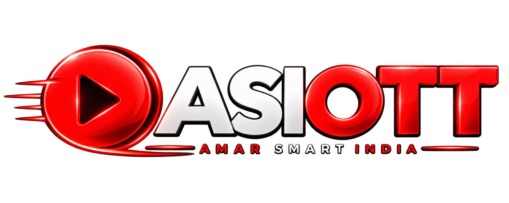

<div align="center">

  

  # ASI OTT
  ### Modern Multi-Source Content Aggregation & High-Performance Streaming Platform

  **Developed by Amar Kumar**

  [](LICENSE)
  [](package.json)
  [](server.js)
  [](render.yaml)
  [](vercel.json)
  [](https://github.com/git-masterontheway/ASI-OTT)

  <p align="center">
    A state-of-the-art, open-source streaming platform that seamlessly aggregates movies, web series, TV shows, and vertical mini dramas across high-speed sources with horizontal on-site video playback, anti-redirect player sandboxing, and zero-redirect direct cloud downloads.
  </p>

</div>

---

## 📖 Open Source Notice

**ASI OTT is 100% open source and available for anyone to use, learn from, fork, and build upon**, subject to the terms of the [MIT License](LICENSE). Contributions, suggestions, and improvements are always welcome!

---

## 🌐 Live Project Access

You can access and test the live running deployment of ASI OTT through any of the following official mirrors (listed in order of preference):

1. **Primary Domain:**  
   👉 [**https://asi-ott.xo.je**](https://asi-ott.xo.je/)  
   *Custom production domain with global CDN acceleration and direct cloud delivery.*

2. **Secondary Mirror (Vercel Serverless Edge):**  
   👉 [**https://asi-ott.vercel.app**](https://asi-ott.vercel.app/)  
   *Serverless edge deployment powered by Vercel for fast global asset delivery.*

3. **Alternative Mirror (Render Web Service):**  
   👉 [**https://asi-ott.onrender.com**](https://asi-ott.onrender.com/)  
   *Persistent backend container on Render with automated scraping memory caching.*

> **Note on Service Availability:**  
> Availability and response time on the secondary and alternative mirrors may occasionally depend on cloud provider deployment cycles or free-tier instance spin-up (e.g., Render free services may take 30-50 seconds to wake from idle). If one mirror is temporarily updating, switch to the primary domain.

---

## ✨ What's New in Version 2.3.0 (Major Release)

### 🎬 1. Dedicated "Movies Central" Hub (`/movies.html`)
- **Zero Mini Drama Guarantee**: Dedicated route and standalone interface completely filtered from mini-drama / vertical content.
- **Pure Referer Category Mapping**: Directly scrapes categorized archives from upstream providers, completely eliminating category bleeding (e.g., Hollywood titles accidentally displaying in Bollywood).
- **5 Clean Content Categories**:
  - **Bollywood Cinema** (Hindi Org & HQ Releases)
  - **Hollywood Dual Audio** (Hindi + English Multi-Audio 4K UHD)
  - **South Hindi Dubbed** (Tollywood, Kollywood, Sandalwood Hindi Dubbed Blockbusters)
  - **Korean & Asian Cinema** (K-Dramas, Asian Cinema, Multi-Audio)
  - **Web Series Archive** (Complete Seasons & Episodes)
- **Top Sticky Navbar with Scrolled Sub-Header**: Navbar stays fixed for 1-click navigation (`Home`, `MOVIES`, `Telegram`), while the search bar and category chips scroll naturally with content to maximize screen viewing area.

---

### 🎥 2. Player 2.0 Streaming Engine (`watch.html` & `player.js`)
- **Buffered Timeline Indicator**: Real-time visualization on the playback scrub bar showing exactly how many seconds/minutes of video are pre-buffered ahead.
- **Smart Seek Zones (10s Skip)**:
  - **Center Click / Tap**: Instant Play / Pause toggle with animated ripple indicator.
  - **Left Zone (Double Click / Tap)**: Smooth -10 seconds rewind with back arrow badge.
  - **Right Zone (Double Click / Tap)**: Smooth +10 seconds fast-forward with forward arrow badge.
- **Full Keyboard Navigation**:
  - `Space` / `K`: Play / Pause toggle
  - `Left Arrow` / `J`: -10 Seconds Seek Backward
  - `Right Arrow` / `L`: +10 Seconds Seek Forward
  - `Up Arrow` / `Down Arrow`: Volume Up / Down (10% increments)
  - `M`: Mute / Unmute toggle
  - `F`: Fullscreen mode toggle
  - `0` to `9`: Jump directly to 0% – 90% of playback timeline
- **Anti-Redirect Sandboxing Shield**: Hardened sandbox security policy on embedded iframe players preventing third-party popups, malicious ads, or unauthorized external domain redirects while allowing seamless video rendering and HTML5 playback.
- **Web Audio 300% Booster**: Integrated Web Audio API GainNode processor enabling sound volume amplification up to 300% for quiet movie releases.
- **Aspect Ratio & Screen Rotation**: 16:9 Widescreen, 9:16 Vertical Mobile Mode, and 4:3 Theater modes with instant orientation lock.

---

### 🛡️ 3. Redesigned Premium OTT Site Footer
- **Universal Uniformity**: Deployed identically across `index.html`, `movies.html`, and `watch.html`.
- **Telegram Community CTA Card**: Glowing frosted banner linking users directly to the official community channel (`@ASI_OTT_discussion`).
- **Quick Browse Genre Strip**: 1-click category jumping (`Bollywood`, `Hollywood`, `South Dubbed`, `Korean`, `Web Series`, `4K UHD`).
- **4-Column Clean Layout**:
  - *Column 1*: Brand identity, mission, and live system status pills (`CDN Edge Network: Online 99.9%`, `Ad Shield: Zero Redirects`).
  - *Column 2*: Explore Content navigation.
  - *Column 3*: Streaming Experience & technical capabilities.
  - *Column 4*: Transparency & DMCA compliance statement framed in a frosted glass card with trust badges (`256-Bit SSL`, `Safe Browsing`, `Fast CDN`).
- **Interactive Back-to-Top**: Smooth scrolling action button returning users to the top of the page.

---

### 🔢 4. Floating Glass OTT Pagination Bar
- **Frosted Glass Capsule**: Clean rounded pill design with glowing borders and dark translucent backing.
- **Current Page Badge**: Visual indicator (`Page X of Y`) providing immediate orientation across large catalogs.
- **Active Page Glow**: Glowing red gradient pill with elevation and drop-shadow.
- **Auto-Scroll to Grid Top**: Clicking any page automatically scrolls smoothly to the top of the content grid.

---

### 🕷️ 5. Crawler & Referer Engine Upgrades (`server.js`)
- **HDHub4u Dynamic Domain Resolution**: Automatically resolves mirrors via `https://hdhub4u.fast/` inspection flow to connect with the latest active domain (e.g. `https://new9.hdhub4u.cl/`) without manual server edits.
- **HDMobi Provider Integration**: Direct catalog scraping and stream extraction from `https://hdmobi.in/`.
- **GHDHub Provider Integration**: Direct download location resolving and media stream aggregation from `https://ghdhub.org/`.
- **MicroTV Referer Endpoint Update**: Synchronized with `m.microtv.st`.
- **Movies4u Multi-Category Archive Scraper**: Dedicated endpoint scraping for `/category/bollywood-movies/`, `/category/hollywood-movies/`, `/category/south-hindi-movies/`, `/category/korean/`, and `/category/web-series/`.

---

## 💡 Future Roadmap & New Ideas (Upcoming Features)

Here are the planned architectural enhancements and innovative features scheduled for upcoming releases:

1. **📱 Progressive Web App (PWA) with Offline Caching**:
   - Full Service Worker support enabling users to install ASI OTT on Windows, macOS, Android, and iOS.
   - Offline metadata caching allowing instant loading of previously visited pages.
2. **📺 Chromecast & AirPlay Integration**:
   - Native Google Cast and Apple AirPlay integration enabling 1-click casting from the browser directly to Smart TVs.
3. **🔊 Audio Delay & Subtitle Sync Offset**:
   - In-player slider control to adjust audio/subtitle delay (+/- 500ms) to fix synchronization issues on multi-audio or third-party subtitles.
4. **🤖 Automated Telegram Release Bot**:
   - Real-time webhook bot posting new movie releases, direct watch links, and 4K download mirrors directly into the `@ASI_OTT_discussion` channel.
5. **⭐ Personalized LocalStorage Watchlist & Continue Watching**:
   - Zero-login local watchlist allowing users to bookmark favorite series and resume movies from their exact last timestamp.
6. **⚡ Peer-to-Peer (WebTorrent / HLS P2P) Mesh Acceleration**:
   - P2P video delivery using WebRTC data channels to reduce server egress bandwidth and provide ultra-fast 4K streaming during peak hours.

---

## 🚀 Local Installation & Execution

### Prerequisites

Ensure you have the following installed on your system:
- **[Node.js](https://nodejs.org/)** (Version `18.0.0` or higher required; `20.x` LTS recommended)
- **[Git](https://git-scm.com/)** command-line tools
- A modern web browser (Google Chrome, Mozilla Firefox, Microsoft Edge, or Safari)

---

### Step 1: Clone the Repository

```bash
git clone https://github.com/git-masterontheway/ASI-OTT.git
cd ASI-OTT
```

---

### Step 2: Install Dependencies

```bash
npm install
```

---

### Step 3: Environment Variable Configuration

Create a `.env` configuration file from the provided `.env.example`:

**On Windows (PowerShell):**
```powershell
Copy-Item .env.example .env
```

**On Linux / macOS / Bash:**
```bash
cp .env.example .env
```

Default values in `.env`:
```ini
# Server Port (Default is 3000; auto-increments if port is busy)
PORT=3000

# Environment Mode: 'development' or 'production'
NODE_ENV=development

# Production Canonical Domain
APP_DOMAIN=https://asi-ott.xo.je
```

---

### Step 4: Start the Server

Start the application:

```bash
npm start
```

Or run in development watch mode:
```bash
npm run dev
```

---

### Step 5: Verify Successful Startup

When the server starts successfully, your terminal will display:

```
===============================================
ASI OTT Server running at: http://0.0.0.0:3000
Environment:               development
Production Domain:         https://asi-ott.xo.je
Health Check:              http://0.0.0.0:3000/health
Home / Search:             http://0.0.0.0:3000
Movies Central:            http://0.0.0.0:3000/movies.html
Watch Page:                http://0.0.0.0:3000/watch
===============================================
```

---

### Step 6: Available Pages & Local Endpoints

| Page / Endpoint | URL | Description |
| :--- | :--- | :--- |
| **Homepage & Search** | [`http://localhost:3000/`](http://localhost:3000/) | Full multi-source catalog, splash screen, category filter dropdown |
| **Movies Central Hub** | [`http://localhost:3000/movies.html`](http://localhost:3000/movies.html) | Dedicated movies hub, no drama content, Bollywood, Hollywood, South, Korean |
| **Watch & Player** | [`http://localhost:3000/watch`](http://localhost:3000/watch) | Video player 2.0, buffered timeline, 10s seek zones, direct downloads |
| **Health Check API** | [`http://localhost:3000/health`](http://localhost:3000/health) | JSON uptime and system health diagnostics |

---

## 📡 API Reference

| Endpoint | Method | Parameters | Description |
| :--- | :--- | :--- | :--- |
| `/health` | `GET` | — | Returns server health, uptime, and deployment environment. |
| `/api/content` | `GET` | `?page=1&category=all` | Aggregates titles by page and category (`all`, `mini_drama`, `movies`, `tv_shows`, `web_series`). |
| `/api/movies/sections` | `GET` | — | Returns 5 distinct categories scraped directly from upstream category endpoints. |
| `/api/search` | `GET` | `?q=query&category=all&no_drama=1` | Parallel search across all source catalogs with drama filtering guard. |
| `/api/post` | `GET` | `?id=:id&source=:source` | Resolves item details, media streams, and download links. |
| `/api/source-stream` | `GET` | `?url=...&referer=...` | Proxies video streams and m3u8 playlists bypassing CORS and anti-hotlinking. |
| `/api/stream-download` | `GET` | `?url=...&filename=...` | Proxies high-speed direct downloads with genuine attachment headers. |
| `/api/views/track` | `POST` | `{ id: "slug" }` | Records unique IP view analytics. |

---

## 📁 Repository Structure

```
ASI-OTT/
├── public/                     # Static frontend assets
│   ├── css/
│   │   └── style.css           # Premium OTT theme, player controls, footer & pagination
│   ├── js/
│   │   ├── app.js              # Home catalog browsing, search & category filters
│   │   ├── movies.js           # Dedicated Movies Hub controller & pagination logic
│   │   └── player.js           # Video player 2.0, buffer timeline, seek zones, shortcuts
│   ├── index.html              # Main landing page with unified search
│   ├── movies.html             # Dedicated Movies Central Hub (Zero Mini Drama)
│   ├── watch.html              # Dedicated media streaming & download interface
│   ├── logo.png                # Official brand logo
│   └── favicon.svg             # Modern vector favicon
├── api/
│   └── index.js                # Serverless bridge for Vercel deployment
├── data/                       # Local database storage (views tracking)
├── server.js                   # Core Express backend, scrapers & dynamic mirror resolution
├── render.yaml                 # Render persistent Web Service configuration
├── vercel.json                 # Vercel serverless edge configuration
├── .env.example                # Example environment configuration
├── package.json                # Project dependencies and startup scripts
├── LICENSE                     # MIT Open Source License
└── README.md                   # Comprehensive project documentation & roadmap
```

---

## 📄 License & Credits

- **Developer:** [Amar Kumar](https://github.com/git-masterontheway)
- **License:** Released under the [MIT License](LICENSE). Free for personal, open-source, and commercial use.

---

<div align="center">
  <b>⭐ If you like this project, please give it a star on GitHub! ⭐</b>
</div>
